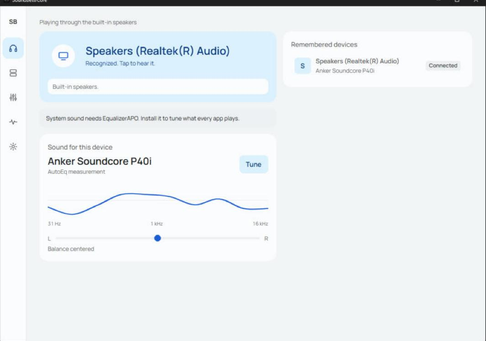
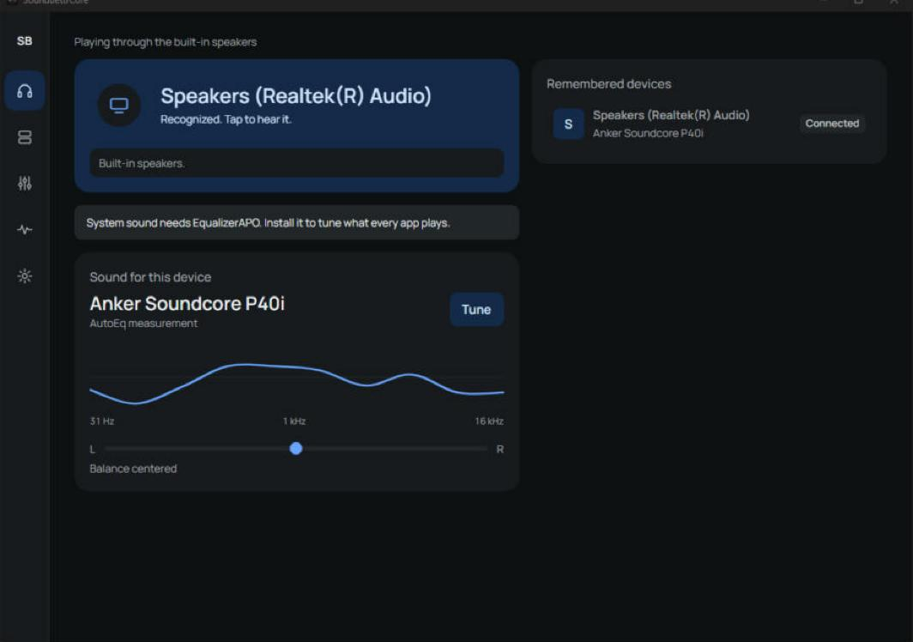
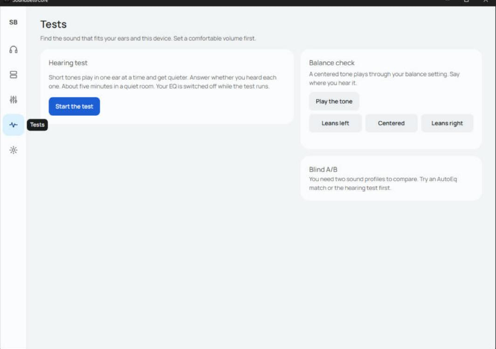
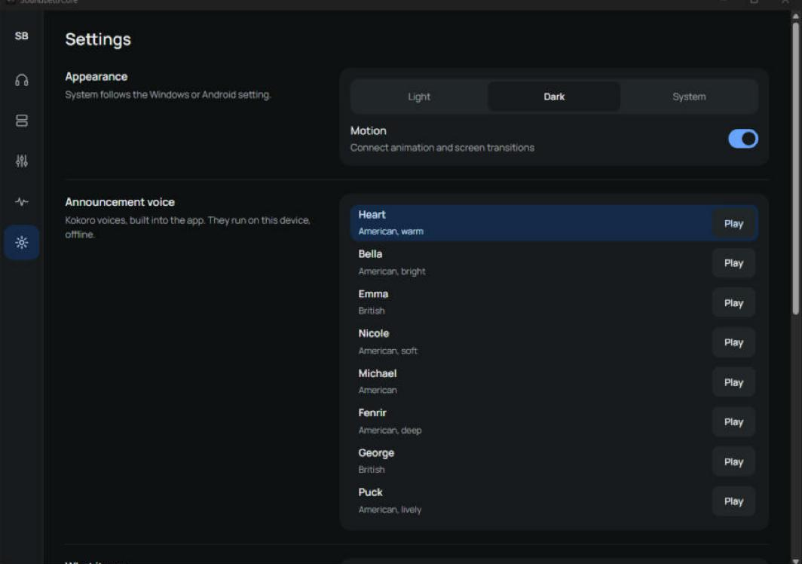

<p align="center"></p>

<h1 align="center">SoundBettrCore</h1>

<p align="center"><b>Your EQ follows whatever you plug in or connect.</b><br>
Every pair of headphones, earbuds or speakers gets its own sound, remembered on your PC and phone. When one connects, the app switches to its sound and tells you, out loud.</p>

<p align="center">
  <a href="https://github.com/jherobred/SoundBettrCore/releases/latest"></a>
  
  <a href="LICENSE"></a>
</p>

<p align="center">
  <a href="https://github.com/jherobred/SoundBettrCore/releases/latest"><b>Download</b></a> ·
  <a href="#what-it-does">What it does</a> ·
  <a href="#install">Install</a> ·
  <a href="#limits">Limits</a> ·
  <a href="#build">Build</a>
</p>

> [!WARNING]
> **Windows SmartScreen will warn you.** The installer is not code-signed (that certificate costs money). Click **More info**, then **Run anyway**. All the code is here to read.

<table>
<tr>
<td width="50%"></td>
<td width="50%"></td>
</tr>
<tr>
<td></td>
<td></td>
</tr>
</table>

## What it does

- **Remembers every output.** Bluetooth earbuds, USB DACs, the headphone jack and built-in speakers each get their own name, color and sound profile. A new output gets a setup card and plays flat until you finish it.
- **Says when it connects.** "Connected to Jhems's R50i NC. Harman fix profile on. Battery 78 percent." The voice is Kokoro, built into the app and run offline. Eight voices, and you can change the wording.
- **Tune.** A 10-band EQ (31 Hz to 16 kHz) with an automatic preamp so boosts never clip, left/right balance, virtual surround and crossfeed.
- **AutoEq.** Search 8,850 measured headphone corrections, bundled with the app, and apply one in a tap. The app fits each correction to its 10 bands (0.84 dB average error across the whole database).
- **Tests.** A hearing test per ear at six frequencies that turns your results into an EQ, a balance check with a centered tone, and a blind A/B between two profiles while you play your own music.
- **Soundcore R50i NC and P30i.** When the earbuds answer over Bluetooth, the app shows their battery, switches noise control, sends the 8-band EQ that lives in the earbuds and toggles gaming mode. Every command shows whether the earbuds confirmed it.
- **Light, dark or system theme**, and motion you can turn off.

## Install

**Windows 10 or 11.** Run `SoundBettrCore-Setup-0.2.0.exe` from [Releases](https://github.com/jherobred/SoundBettrCore/releases/latest). The app lives in the tray, so it keeps announcing connections with the window closed.

To change the sound of every app (Spotify, YouTube, games), install [EqualizerAPO](https://sourceforge.net/projects/equalizerapo/) and pick your outputs in its Configurator. Then press **Connect EqualizerAPO** in SoundBettrCore. Windows asks for permission once. Without EqualizerAPO, the announcements, device memory, AutoEq and R50i controls still work.

**Android 10 or later.** Install `SoundBettrCore-0.2.0-android.apk` from [Releases](https://github.com/jherobred/SoundBettrCore/releases/latest). Allow Nearby devices (for the earbuds) and notifications (the background service shows one). The first launch unpacks the voice, which takes a few seconds.

## Limits

- **The R50i NC is not in AutoEq.** Nobody has published a measurement of it. The closest measured siblings are the Soundcore P25i and P40i.
- **Android cannot tell two wired headsets apart.** The jack reports every set the same way. If you save more than one, the app asks which one is plugged in.
- **Some Android phones block apps from changing other apps' sound** (audio session 0). The app says so when it happens, and on the R50i NC the earbuds' own EQ still works.
- **Surround on Windows** uses EqualizerAPO's virtual channels with SADIE II impulse responses for two speakers in front of you. **On Android** it uses the phone's own Virtualizer effect where the phone allows it.
- The hearing test measures your hearing **relative to this device**. It is not a medical hearing test.

## Privacy

Everything runs on your device. There are no accounts and no analytics. The only internet use is the **Update** button for the AutoEq database in Settings, and only when you press it.

## Build

Needs Windows, Node 22+, Rust 1.85+, JDK 21, the Android SDK and NDK, and `gh` (to fetch the voice model).

```powershell
pwsh scripts/fetch-models.ps1   # Kokoro voice, about 160 MB, into app/src-tauri/resources/kokoro
pwsh scripts/build-release.ps1  # tests, then dist/: Windows Setup, Android APK, SHA256SUMS.txt
```

Windows Controlled Folder Access blocks build tools from writing inside `Documents`, so every build and test runs through `scripts/stage.ps1`, which mirrors the repo to `C:\Users\J30N\.sbc-build`.

| Folder | What |
|---|---|
| `app/src` | The UI: React and TypeScript |
| `app/src-tauri/src` | The Rust core: devices, profiles, EQ math, AutoEq, the voice, the hearing test, EqualizerAPO and R50i control |
| `app/android/kotlin` | Android: the background service, DynamicsProcessing, Bluetooth, and the JNI bridge to the core |
| `scripts` | Staging, release build, and the AutoEq, HRIR and model preparation |

## Credits

- Voice: [Kokoro 82M](https://huggingface.co/hexgrad/Kokoro-82M) by hexgrad, run with [sherpa-onnx](https://github.com/k2-fsa/sherpa-onnx) (both Apache 2.0).
- Headphone corrections: [AutoEq](https://github.com/jaakkopasanen/AutoEq) by Jaakko Pasanen (MIT).
- Surround: [SADIE II](https://www.york.ac.uk/sadie-project/database.html) head-related impulse responses, University of York (Apache 2.0).
- R50i NC protocol details were checked against [OpenSCQ30](https://github.com/Oppzippy/OpenSCQ30).
