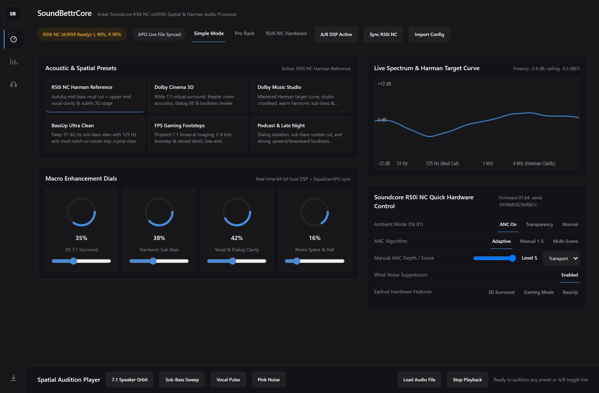
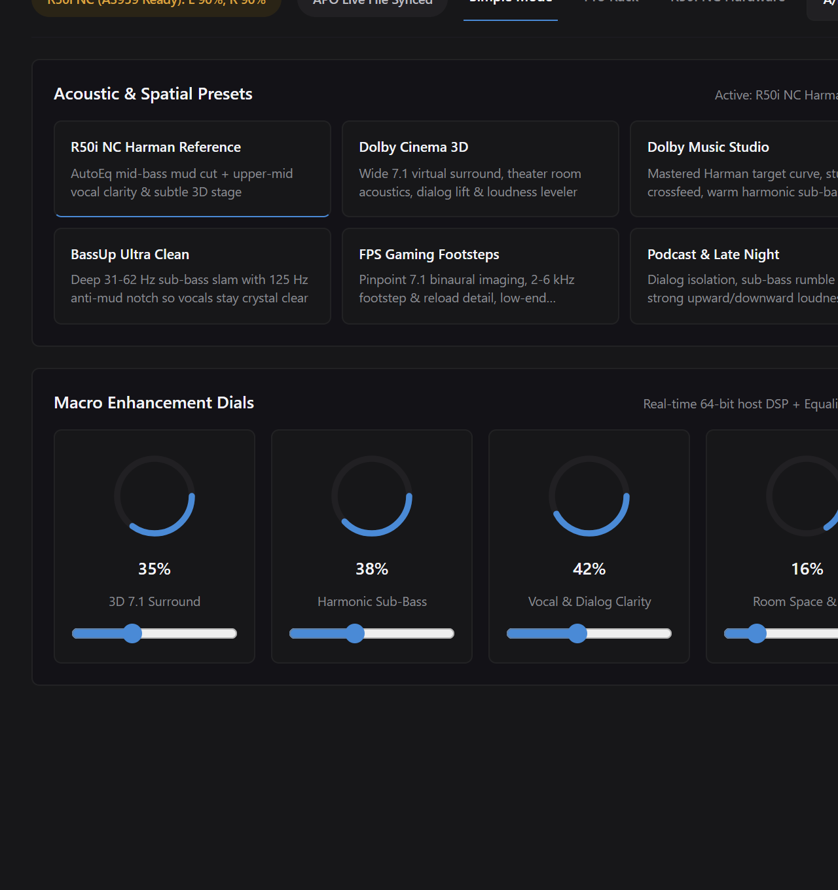
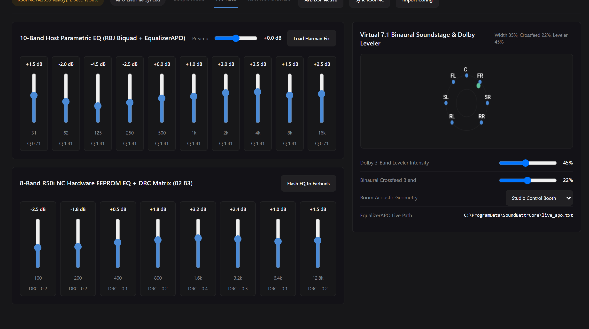
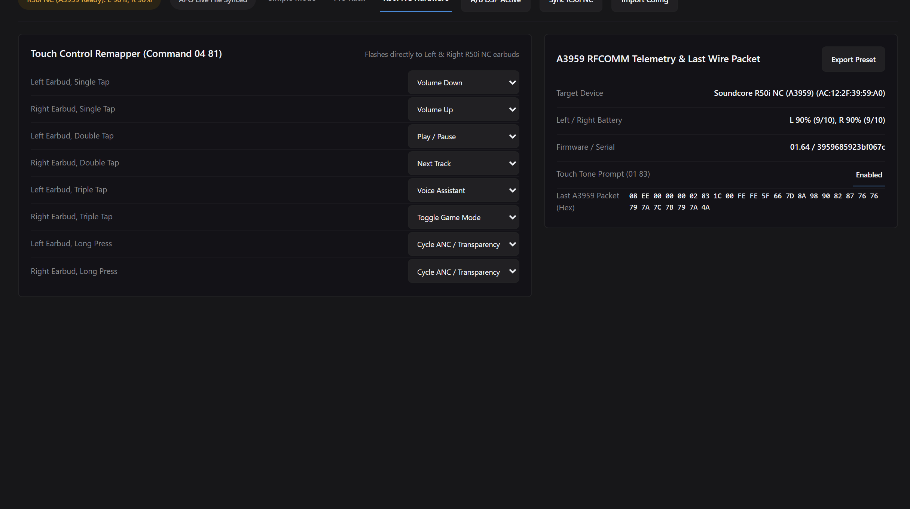
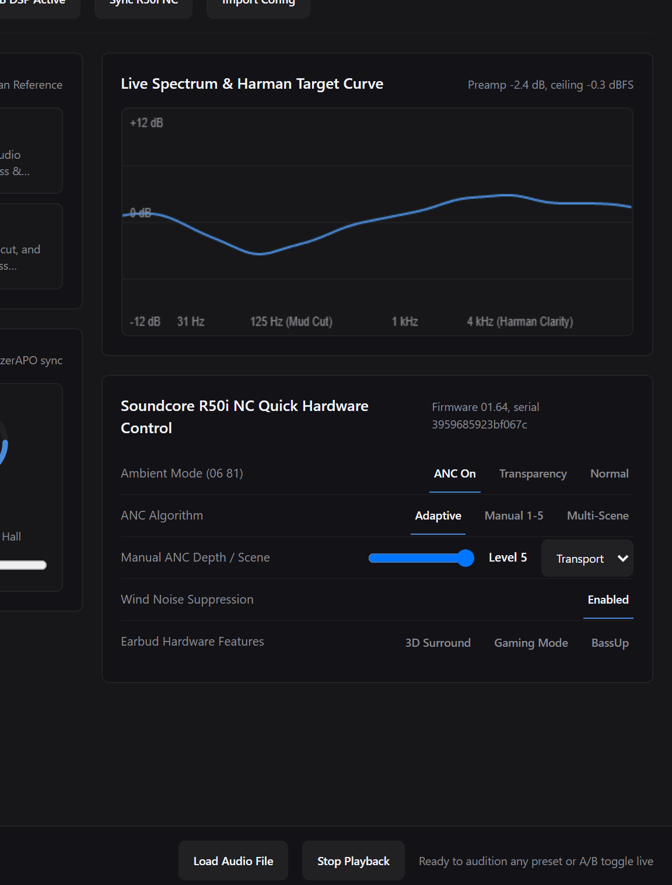

<p align="center"></p>

<h1 align="center">SoundBettrCore</h1>

<p align="center"><b>Make your Anker Soundcore R50i NC sound significantly better.</b><br>
Cuts the factory upper-bass mud, restores vocal clarity, adds 3D 7.1 surround and Dolby-style loudness leveling, and talks directly to the earbuds over Bluetooth RFCOMM.</p>

<p align="center">
  <a href="https://github.com/jherobred/SoundBettrCore/releases/latest"></a>
  <a href="https://github.com/jherobred/SoundBettrCore/releases"></a>
  
  <a href="LICENSE"></a>
</p>

<p align="center">
  <a href="https://github.com/jherobred/SoundBettrCore/releases/latest"><b>Download</b></a> ·
  <a href="#windows-and-the-dsp-rack">Windows</a> ·
  <a href="#android">Android</a> ·
  <a href="#r50i-nc-hardware-control">R50i NC Hardware</a> ·
  <a href="#install">Install</a> ·
  <a href="#build">Build</a>
</p>

> [!WARNING]
> **Windows will say this is a virus. It's not, I promise 😭**
> I just don't have the paid code-signing certificate that makes Windows trust an app, so SmartScreen panics at anything unsigned. Click **More info**, then **Run anyway**. Every line of code is right here if you want to check.

<p align="center">
  
</p>

## What's in 0.1

- **R50i NC Harman / AutoEq target correction.** Cuts the stock `62 to 250 Hz` bloat (`-4.2 dB` at `125 Hz`, `-3.4 dB` at `250 Hz`) that makes vocals sound veiled, and lifts `2 to 4 kHz` presence (`+3.2 dB` at `2 kHz`, `+3.8 dB` at `4 kHz`) with sub-bass extension down to `28 Hz`.
- **3D Binaural 7.1 Virtual Surround and Crossfeed.** Places `L, R, C, LFE, LS, RS, LB, RB` virtual speakers outside your head with ITD/ILD cues, pinna notches, and a `650 Hz` (`-4.5 dB`) crossfeed network.
- **Dolby-style 3-band Compressor, Loudness Leveler, and Limiter.** Linkwitz-Riley 4th-order crossovers at `200 Hz` and `2500 Hz` keep quiet dialogue and detail audible while a `-0.3 dBFS` brickwall peak limiter prevents clipping.
- **Harmonic Sub-Bass Exciter and Room Acoustics.** Generates clean sub-bass harmonics (`30 to 90 Hz`) without muddying the midrange, paired with a Schroeder/Freeverb room simulator (`Studio`, `Small Room`, `Cinema`, `Concert Hall`).
- **Direct R50i NC (`A3959`) Bluetooth RFCOMM hardware control** on both Windows and Android. No Soundcore account or cloud login needed.
- **Built-in 7.1 Test Bench and Local Audio Player** with instant **A/B Bypass** so you can hear the exact difference right away.

## Windows and the DSP rack

<table>
<tr>
<td width="50%"></td>
<td width="50%"></td>
</tr>
<tr>
<td><b>One-click presets and four macro dials.</b><br>Pick R50i NC Harman Target Fix, Dolby Cinema 7.1, BassHead Clean, Vocal &amp; Podcast Clear, FPS Footstep Radar, or Late Night Leveler, then dial in Sub-Bass Weight, Vocal Presence, 3D Surround Width, and Dolby Leveler.</td>
<td><b>10-band Host EQ + 8-band Hardware EEPROM EQ.</b><br>Shape the 10-band parametric biquad curve on your PC or phone, or flash an 8-band hardware curve with exact A3959 Dynamic Range Compression directly into the earbuds.</td>
</tr>
<tr>
<td></td>
<td></td>
</tr>
<tr>
<td><b>Full R50i NC hardware control over Bluetooth.</b><br>Switch ANC, Transparency, and Normal modes, set Manual 1 to 5 or Adaptive ANC, toggle Wind Noise Suppression, BassUp, 3D Surround, and Gaming Mode, and remap touch controls.</td>
<td><b>Built-in 7.1 test bench and live spectrum.</b><br>Run the 7.1 speaker orbit, sub-bass sweep, vocal presence pulse, or pink noise generator, or load your own WAV, MP3, FLAC, or OGG track and flip A/B Bypass in real time.</td>
</tr>
</table>

- **System-wide Windows audio via EqualizerAPO.** Every slider and preset writes live filter directives (`Preamp`, `Filter PK`, `Copy` crossfeed, and room convolution parameters) to `C:\ProgramData\SoundBettrCore\live_apo.txt`, which EqualizerAPO reloads in under `15 ms` with zero audio dropouts.
- **Works without EqualizerAPO too.** The built-in 7.1 Test Bench, local audio file player, and R50i NC Bluetooth EEPROM flasher work out of the box on any Windows 10 or 11 PC.
- **System tray integration.** Closes to the Windows tray with quick preset switching and one-click DSP bypass.
- **Import and export.** Load or save presets as `.json` or standard EqualizerAPO `.txt` files.

## Android

- **System-wide Android 10+ DSP (`DynamicsProcessing`).** Attaches a foreground `mediaPlayback` + `connectedDevice` service (`SoundBettrService`) to global output mix session `0` (with fallback to active player sessions), running a 10-band pre-EQ, 3-band multi-band compressor (`Mbc`), post-EQ harmonic shelves, and a `-0.3 dBFS` brickwall limiter across your music and video apps.
- **Quick Settings Tile.** Pull down your phone's notification shade and tap **SoundBettr R50i** to toggle processing on or off without leaving your current app.
- **Same 6 presets, Simple/Pro Rack, 7.1 Test Bench, and R50i NC Bluetooth RFCOMM control** as the Windows app, built natively with Kotlin and Jetpack Compose.

## R50i NC hardware control

SoundBettrCore speaks the binary Soundcore `A3959` protocol directly over Bluetooth RFCOMM (`08 ee 00 00 00 <cmd_hi> <cmd_lo> <len_lo> <len_hi> <body> <crc>`):

- **Noise Control (`06 81`):** Switch between **ANC**, **Transparency**, and **Normal**. Choose **Manual Level 1 to 5**, **Adaptive ANC**, or **Multi-Scene** (`Transport`, `Outdoor`, `Indoor`), toggle **Vocal Transparency**, and turn on **Wind Noise Suppression**.
- **8-Band Hardware EEPROM EQ + DRC (`02 83`):** Writes 8 hardware bands (`100 Hz`, `200 Hz`, `400 Hz`, `800 Hz`, `1.6 kHz`, `3.2 kHz`, `6.4 kHz`, `12.8 kHz`) plus the 8-band `A3959` Dynamic Range Compression matrix directly into the earbuds' onboard memory, so the tuning stays on the earbuds across every device.
- **Onboard 3D Surround (`02 86`) and Gaming Mode (`01 87`):** Toggle the earbud DSP's native 3D surround widening and low-latency gaming mode.
- **Touch Control Remapping (`04 81`):** Remap Left and Right single-tap, double-tap, triple-tap, and long-press actions (`Volume Up/Down`, `Play/Pause`, `Next/Previous Track`, `ANC Cycle`, `Voice Assistant`, `Game Mode`, or `Disabled`).
- **Live Battery and Firmware (`01 01`):** Reads separate Left and Right earbud battery percentages (`0 to 100%`), charging flags, firmware version, and serial number.

## Install

**Windows**

1. Download `SoundBettrCore-Setup-0.1.0.exe` from [Releases](https://github.com/jherobred/SoundBettrCore/releases/latest). When SmartScreen warns, choose **More info**, then **Run anyway**.
2. Setup installs `SoundBettrCore.exe` to `%LOCALAPPDATA%\Programs\SoundBettrCore`, creates a Start Menu shortcut, adds an uninstall entry in Installed Apps, and automatically hooks EqualizerAPO (`C:\Program Files\EqualizerAPO\config\config.txt`) if EqualizerAPO is installed.

`SoundBettrCore-0.1.0-portable.exe` (also checked into the repo root as `SoundBettrCore.exe`) runs without installing.

**Android**

Install `SoundBettrCore-0.1.0-android.apk` (also checked into the repo root as `SoundBettrCore.apk`, Android 10+) from [Releases](https://github.com/jherobred/SoundBettrCore/releases/latest), and allow Nearby Devices (`BLUETOOTH_CONNECT` / `BLUETOOTH_SCAN`) when prompted so the app can talk to your paired R50i NC earbuds.

## Limits

- Direct Bluetooth RFCOMM hardware commands target the **Anker Soundcore R50i NC** (`A3959`) and **Soundcore P30i** (which shares the `A3959` firmware protocol). The host 5-stage DSP, EqualizerAPO engine, Android `DynamicsProcessing` service, and 7.1 Test Bench work with any headphones or earbuds.
- System-wide Windows processing across third-party apps uses [EqualizerAPO](https://sourceforge.net/projects/equalizerapo/). Without EqualizerAPO installed, the built-in 7.1 Test Bench, local audio player, and R50i NC Bluetooth EEPROM EQ flasher still work normally.
- Some Android OEM builds restrict global audio session `0` attachment for third-party equalizers. When that happens, flashing the 8-band curve to the R50i NC hardware EEPROM (`02 83`) still applies your tuning across every app on the phone.

## Privacy

Everything runs locally on your PC and phone. There are no accounts, no telemetry, no analytics, and no network requests.

## Build

Needs Windows, Rust 1.85+, JDK 21, and the Android SDK (`C:\Users\J30N\android-sdk`, platform 37.2):

```powershell
cargo test --manifest-path desktop/src-tauri/Cargo.toml
pwsh -File scripts/build-release.ps1
```

The release script runs the Rust and Android JUnit test suites, builds the portable Windows app, embeds it into the Windows Setup installer, assembles the Android APK, copies `SoundBettrCore.exe` and `SoundBettrCore.apk` to the repo root, and writes all release binaries plus `SHA256SUMS.txt` to `dist/`.

| Folder | What |
|---|---|
| `desktop/src-tauri/` | Windows app, Tauri 2, Rust 5-stage DSP, EqualizerAPO writer, WinRT RFCOMM client, and WebAudio UI |
| `installer/` | Windows Setup installer and uninstaller, Rust + Win32 + EqualizerAPO hook |
| `android/` | Android app, Kotlin, Jetpack Compose, `DynamicsProcessing` service, Quick Settings tile, and RFCOMM client |
| `dist/` | Ready-to-run Setup `.exe`, Portable `.exe`, Android `.apk`, and `SHA256SUMS.txt` |
| `brand/` | Vector icon source |
| `docs/` | UI screenshots, design spec, and implementation plan |

## License

MIT. See [LICENSE](LICENSE).
